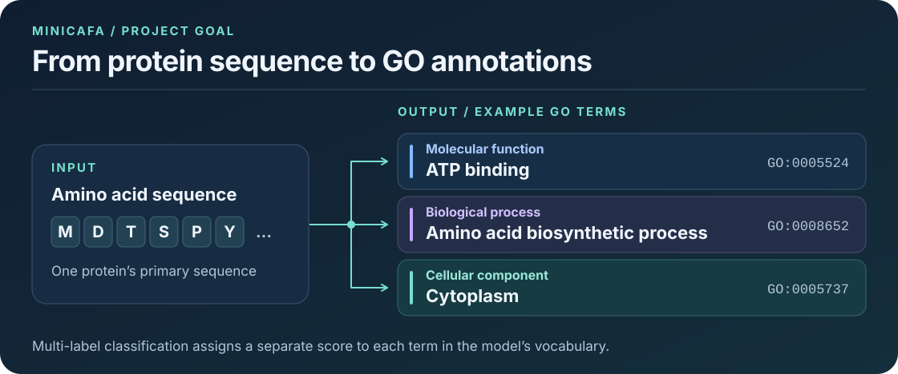

# miniCAFA

**Predict protein function from an amino acid sequence.**

miniCAFA is a notebook-based PyTorch project that predicts Gene Ontology (GO) annotations from a protein’s primary sequence. GO terms describe what a protein does, which biological processes it participates in, and where it acts in the cell. A protein can have several annotations, so miniCAFA treats prediction as **multi-label classification**, with a separate score for each GO term in the model’s vocabulary. [Gene Ontology overview](https://geneontology.org/docs/ontology-documentation/)



## How the pipeline works


1. **Prepare labeled proteins.** Read sequences and their GO cross-references from the compressed UniProtKB/Swiss-Prot flat file. The training notebook keeps sequences up to 1,000 residues, retains terms observed at least 100 times before subsampling, and samples up to 15,000 proteins. An approximately 80/10/10 random split provides training, validation, and test partitions.
2. **Encode each sequence in two ways.** A 20-channel one-hot representation goes through parallel residual 1D CNN branches with kernel sizes 3, 5, and 9. Global max and mean pooling produce a fixed-length embedding. In parallel, an MLP processes **425 sequence-derived features**: 20 amino acid frequencies, 400 dipeptide frequencies, and five descriptors for average residue mass, charge, hydrophobicity, aromaticity, and log sequence length.
3. **Combine the representations.** A feed-forward classifier takes the concatenated CNN and MLP embeddings and produces one logit per GO term. Training uses Adam and binary cross-entropy with logits. At prediction time, sigmoid converts the logits to per-term scores.
4. **Tune and evaluate.** Optuna searches model and training settings using five-fold cross-validation over the combined training and validation partitions. For a completed trial, the notebook can average the five fold models’ scores on the held-out test partition and apply a threshold to select predicted terms.

## Getting started

### Install the dependencies

The notebooks were developed with Python 3.11. From an active Python environment, install the dependencies and start JupyterLab from the repository root.

```bash
python -m pip install jupyterlab torch numpy pandas scikit-learn scipy matplotlib seaborn statsmodels optuna tqdm tensorboard
python -m jupyter lab
```

### Download the data

Download the compressed **Swiss-Prot text flat file** and save it as `data/uniprot_sprot.dat.gz`. Keep it compressed. The parser reads the GO cross-references in the flat file. [Swiss-Prot flat-file download](https://ftp.uniprot.org/pub/databases/uniprot/current_release/knowledgebase/complete/uniprot_sprot.dat.gz)

### Train the model

Open [the model training notebook](notebooks/model_training.ipynb). Run the imports, the `build_dataloaders(...)` cell, and the model and training definitions through `best_trials, best_params = build_best_model(...)`. The notebook resolves data and output paths relative to `notebooks/`. If worker processes fail to start in Jupyter, set each `num_workers` argument in the training notebook to `0`.

Training uses CUDA when PyTorch detects it and otherwise runs on CPU. The default search schedules 20 Optuna trials with up to five folds and ten epochs per fold. Use a fresh checkout or save any existing run outputs before restarting the search, since trial numbering starts at zero. Checkpoints go to `src/models/run1/trial_<id>/` and TensorBoard logs go to `src/runs/`.

```bash
tensorboard --logdir src/runs
```

### Evaluate a fresh run

After training, run the cell that defines `ensamble` and use the following in a new notebook cell. Set `trial_number` to a completed trial from the current Optuna run. The example loads its five fold checkpoints and uses the test loader from that same run.

```python
from sklearn.metrics import f1_score

trial_number = 0
fold_models = []
for fold in range(5):
    path = f"../src/models/run1/trial_{trial_number}/fold_{fold}.pth"
    checkpoint = torch.load(path, map_location=DEVICE)
    params = checkpoint["hiperparameters"]
    model = ProteinFunctionPredictor(
        physics_dim=norm_stats["physics_dim"],
        num_go_terms=norm_stats["num_go_terms"],
        cnn_channels=params["cnn_channels"],
        cnn_depth=params["cnn_depth"],
        mlp_hidden_dims=params["mlp_hidden_dims"],
        dropout=params["dropout"],
    ).to(DEVICE)
    model.load_state_dict(checkpoint["model_state_dict"])
    fold_models.append(model)

result = ensamble(fold_models, test_loader, threshold=0.25)
print(f1_score(result["labels"], result["predictions"], average="micro"))
print(mlb.classes_[result["predictions"][0].astype(bool)])  # First protein's GO terms
```

`result` also contains mean scores and the standard deviation of scores across fold models. Its columns follow the GO term order in `mlb.classes_`.

The notebook also contains cells for reloading historical trials. Those cells assume local checkpoints and a specific label vocabulary. Saved notebook outputs show a mismatch between historical checkpoint outputs and target dimensions, so the historical metrics should be treated as exploratory. Matching the exact GO term order matters when comparing predictions with annotations.

## Explore the smaller dataset

The data exploration notebooks form a separate workflow from model training.

1. [Build the dataset](notebooks/load_data.ipynb) from Swiss-Prot. The notebook keeps the 20 most frequent GO terms among the entries it initially reads and exports `data/mini_cafa.csv`.
2. [Clean and analyze it](notebooks/data_analysis_2.ipynb). This notebook removes duplicate sequences and filters sequences with more than 5% nonstandard residues. It explores label imbalance, fits the feature scaler on the training split, and saves feature matrices and split indices under `data/`.

The saved exploration run contains **64,659 proteins after cleaning**. Dataset files and `.pth` checkpoints are excluded by Git, so a fresh checkout requires the Swiss-Prot download and regeneration of local artifacts. Dataset sizes and label counts can change with the Swiss-Prot release and the random split.

## Repository guide

- [`notebooks/model_training.ipynb`](notebooks/model_training.ipynb) defines the predictor, trains it, and contains ensemble evaluation experiments.
- [`notebooks/load_data.ipynb`](notebooks/load_data.ipynb) builds the 20-term dataset, and [`notebooks/data_analysis_2.ipynb`](notebooks/data_analysis_2.ipynb) is the main exploration and preprocessing notebook. [`notebooks/data_analysis.ipynb`](notebooks/data_analysis.ipynb) is an earlier exploratory pass.
- [`src/parser.py`](src/parser.py) reads Swiss-Prot records, and [`src/data.py`](src/data.py) prepares labels and PyTorch data loaders.
- [`src/encoder.py`](src/encoder.py) implements the residual sequence CNN, and [`src/feature_extraction_1.py`](src/feature_extraction_1.py) computes the sequence descriptors.

## Experiment scope

The direct training workflow scales descriptors before splitting and uses random splits that can place closely related proteins in different partitions. Performance on sequence families absent from training remains unmeasured.

The terms illustrated above are examples from the exploration dataset. [ATP binding](https://amigo.geneontology.org/amigo/term/GO%3A0005524), [amino acid biosynthetic process](https://amigo.geneontology.org/amigo/term/GO%3A0008652), [cytoplasm](https://www.ebi.ac.uk/QuickGO/term/GO:0005737)
